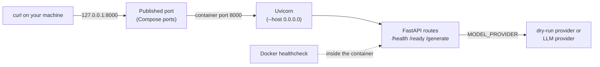

# Container Contract

The supplied service in [src/deployment_service](src/deployment_service/) is
a small text-generation API. A client sends a prompt to `POST /generate`, and
the service answers from its cache or forwards the prompt to an LLM provider
(Groq by default). In **dry-run mode**, an offline provider returns a fixed
answer instead, so no API key is needed. Two
lightweight routes, `/health` and `/ready`, let Docker check the service
without generating text.

In this lesson you run the service in Docker and follow one request from your
terminal into the container. For it to arrive, the app's port, the published
port, the environment variables, and the health check have to line up. These
settings form the **container contract** between the container and whatever
runs it.



## Read The Container Configuration

Two files define how the API runs in Docker. The [`Dockerfile`](Dockerfile)
builds the image: it installs the dependencies from `uv.lock`, copies `src/`,
and starts Uvicorn as a non-root user with `--host 0.0.0.0 --port 8000`, so the
app listens on all of the container's network interfaces.

The [`Docker Compose`](docker-compose.yaml) file adds the runtime settings that should not
be baked into the image, and connects the container to your machine:

```yaml
services:
  api:
    build: .
    ports:
      - "127.0.0.1:8000:8000"
    env_file:
      - path: .env
        required: false
    environment:
      MODEL_PROVIDER: ${MODEL_PROVIDER:-groq}
    healthcheck:
      test: ["CMD", "python", "-c", "import urllib.request; urllib.request.urlopen('http://localhost:8000/health')"]
      interval: 10s
      timeout: 3s
      retries: 5
```

- **`build: .`** builds the image from the Dockerfile in the repository root.
- **`ports`** uses the format `host_ip:host_port:container_port`. Requests to
  port 8000 on your machine are forwarded to port 8000 in the container. The
  `127.0.0.1` prefix publishes the port only on your machine; without it,
  Docker publishes on every network interface, and other devices on your
  network could reach the API.
- **`env_file`** loads the variables from `.env` into the container when it
  starts, so API keys never become part of the image. `required: false` lets
  Compose start even when no `.env` exists.
- **`environment`** values override the ones from `env_file`. Compose resolves
  `${MODEL_PROVIDER:-groq}` on your machine before the container starts: it
  uses `MODEL_PROVIDER` from your shell first, then from `.env`, and falls back
  to `groq`. That is why prefixing the start command below with
  `MODEL_PROVIDER=dry` selects dry-run mode, whatever `.env` says.
- **`healthcheck`** makes Docker run the `test` command inside the container
  every 10 seconds. The command uses Python's standard library because the
  slim base image has no `curl`. The container counts as healthy when
  `/health` responds, and as unhealthy after five failures in a row. The check
  only confirms that the HTTP route answers; it does not generate text.

## Start The Local Service

From the repository root, start the service in dry-run mode:

```bash
MODEL_PROVIDER=dry docker compose up --build --wait
```

- `MODEL_PROVIDER=dry` overrides the provider from `.env`, as described above,
  so no API key is needed.
- `--build` rebuilds the image from your current files before starting it.
- `--wait` runs the container in the background and returns only once the
  health check reports it as healthy.

The first build can take longer while Docker downloads the base image and the
dependencies. Then check the container:

```bash
docker compose ps
```

The `STATUS` column should show the `api` service as `Up` and `(healthy)`. Keep
it running: the later lessons send requests to the same container.

If the command fails, read the logs with `docker compose logs api`. Two common
causes:

- **Port 8000 is already in use**, for example by another app or a container
  from an earlier run. Stop it and start again.
- **The prefix is missing.** Your `.env` sets `MODEL_PROVIDER=groq`, and
  without a key the app refuses to start. The logs end with
  `ValueError: GROQ_API_KEY is required for live mode`.

## Verify The API

The two check routes in [`app.py`](src/deployment_service/app.py) answer
different questions:

```python
@app.get("/health")
def health() -> dict[str, str]:
    """Confirm that the process and HTTP router are alive."""
    return {"status": "healthy"}


@app.get("/ready")
def ready() -> dict[str, str]:
    """Expose configuration readiness without calling the provider."""
    return {"status": "ready", "provider": settings.provider, "model": settings.model}
```

`/health` only shows that the process is running and answering HTTP requests,
which is all the Docker health check needs. `/ready` also reports which
provider and model the service was configured with, so you can confirm the
container picked up the settings you intended. Neither route calls the
provider, so checking them costs nothing.

Send both checks and one generation request:

```bash
curl -i http://127.0.0.1:8000/health
curl -i http://127.0.0.1:8000/ready
curl -i -X POST http://127.0.0.1:8000/generate \
  -H "Content-Type: application/json" \
  -d '{"prompt":"Explain container readiness briefly."}'
```

Each request should return `HTTP/1.1 200 OK`, followed by these bodies:

```json
{"status":"healthy"}
{"status":"ready","provider":"dry","model":"openai/gpt-oss-20b"}
{"text":"Dry response: Explain container readiness briefly.","model":"dry:openai/gpt-oss-20b","usage":{"input_tokens":4,"output_tokens":6},"cache_hit":false,"latency_ms":0.18,"estimated_cost_usd":0.0}
```

Your `latency_ms` will differ. Sending the same prompt again returns
`"cache_hit":true`, because the service answers repeated prompts from its cache.

| Request | What it proves |
|---|---|
| `GET /health` | The process and HTTP route respond. |
| `GET /ready` | The app started with the intended configuration: `"provider":"dry"`. |
| `POST /generate` | The full generation path works. The `dry:` prefix in `model` shows the dry-run provider answered, not a live provider. |

FastAPI validates the request body against
[`GenerateRequest`](src/deployment_service/models.py) before calling the handler.
The handler passes it to [`GenerationService`](src/deployment_service/service.py),
which checks the cache and calls the provider only on a miss. Send a prompt
that contains only spaces:

```bash
curl -i -X POST http://127.0.0.1:8000/generate \
  -H "Content-Type: application/json" \
  -d '{"prompt":"   "}'
```

Expect `HTTP/1.1 422 Unprocessable Content`:

```json
{"detail":[{"type":"string_too_short","loc":["body","prompt"],"msg":"String should have at least 1 character","input":"   ","ctx":{"min_length":1}}]}
```

`GenerateRequest` strips the whitespace, and the empty prompt fails its
minimum length before the handler runs. A failed model call looks different:
it reaches the handler, which returns `504` for a timeout and `502` for any
other provider error.

## Exercise: Change The Model Without Rebuilding

The Docker image contains the code and its dependencies. Which model and provider the
service uses is configuration. Follow these steps to switch the model without
building a new image.

1. In `.env`, change `GROQ_MODEL` to `openai/gpt-oss-120b`.

2. Restart the service **without** `--build`, still in dry-run mode:

   ```bash
   MODEL_PROVIDER=dry docker compose up --wait
   ```

   The command ends with the `api` container marked `Healthy`. Run
   `docker compose ps`: the `STATUS` column shows the container has been up
   for only a few seconds, because Compose replaced it with a new one.

3. Check which model the service reports:

   ```bash
   curl http://127.0.0.1:8000/ready
   ```

   Expected output:

   ```json
   {"status":"ready","provider":"dry","model":"openai/gpt-oss-120b"}
   ```

4. **Optional, with a Groq Free plan key in `.env`:** explicitly select Groq,
   then send the `/generate` request from
   [Verify The API](#verify-the-api) again:

   ```bash
   MODEL_PROVIDER=groq docker compose up --wait
   curl -i -X POST http://127.0.0.1:8000/generate \
     -H "Content-Type: application/json" \
     -d '{"prompt":"Explain container readiness briefly."}'
   ```

   The response now shows the Groq model without the `dry:` prefix, real token
   counts in `usage`, and a much higher `latency_ms`, because the request
   travels to the provider and back. Without a key, the container exits
   instead, as described in [Start The Local Service](#start-the-local-service).

5. Set `GROQ_MODEL` back to `openai/gpt-oss-20b` in `.env` and switch back to
   dry-run mode. The next lessons expect it.

   ```bash
   MODEL_PROVIDER=dry docker compose up --wait
   ```

Notice how **no rebuild was needed**. The app reads its settings once, when it starts.
Because the container's environment changed, Compose replaced the container
with a new one from the same image, and the new process picked up the new
model. The in-memory cache starts empty in each new container. A hosting
platform works the same way: you change a provider, a model, or a rotated API
key in the platform's environment settings, and the service restarts from the
image it already has.

## Check Your Understanding

1. Does a successful `/health` response establish that inference works?
2. Why does `/ready` avoid calling the model?
3. Why should an API key be passed to a container at runtime instead of being written into the Dockerfile or copied into the image?

<details>
<summary>Show Reference Answers</summary>

1. No. It establishes HTTP liveness; inference needs a separate check.
2. Readiness can be checked often, and calling the model on every check would consume quota and money. `/ready` reports the configuration, not whether the provider is available.
3. Anyone who can pull or inspect the image can read its layers, so a key baked into it leaks wherever the image is shared, for example through a registry. Rotating the key would also require a rebuild. Passing it at runtime keeps one image for every environment, with each environment supplying its own secrets.

</details>
