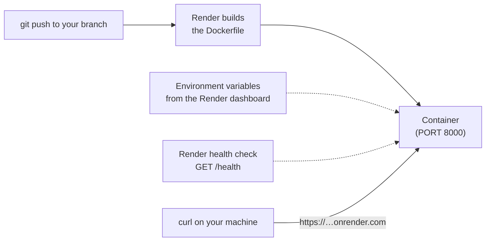

# Render Deployment

[Render](https://render.com/) is a hosting platform that builds a Docker image
from your Git repository and runs it on a public HTTPS address. In this lesson
you create one Free Render web service manually and deploy the container from
lesson 01. The container contract stays the same; only the platform that
supplies the port, the environment variables, and the health check changes.

The service deploys in dry-run mode, so you need a Render account but no API
key. Switching the deployment to Groq for live answers is an optional step.



## Read The Service Configuration

[`render.yaml`](render.yaml) is a **Blueprint**: it describes the services
Render should create and how to build and run them. In our test, the Blueprint
creation flow asked for a payment method even on the Free instance plan.
Use **New > Web Service** for this lesson instead. The Blueprint is a reference
for the shared settings and defaults to Groq; the manual lab uses `dry`.

```yaml
services:
  - type: web
    name: mle-containerized-llm-service
    runtime: docker
    plan: free
    dockerfilePath: ./Dockerfile
    dockerContext: .
    healthCheckPath: /health
    autoDeployTrigger: commit
    envVars:
      - key: PORT
        value: "8000"
      - key: MODEL_PROVIDER
        value: groq
      - key: GROQ_MODEL
        value: openai/gpt-oss-20b
      - key: GROQ_API_KEY
        sync: false
      - key: MAX_CONCURRENT_REQUESTS
        value: "4"
      - key: REQUEST_TIMEOUT_SECONDS
        value: "30"
```

Most fields have a counterpart in the Compose file:

- **`type: web`** and **`name`** create one public web service. The service
  name becomes part of its `onrender.com` address. In the form, the **Name**
  field takes this role and is prefilled with your repository name.
- **`runtime: docker`**, **`dockerfilePath`**, and **`dockerContext`** play
  the role of `build: .`. Render builds the same Dockerfile from the repository
  root. It does not use the image already on your laptop, so only committed
  and pushed changes reach the deployment.
- **`plan: free`** runs one instance within Render's free usage limits. A Free
  instance stops after 15 minutes without traffic. The exercise below measures
  how long the first request waits for it to start again.
- **`autoDeployTrigger: commit`** redeploys the service after every push to the
  connected branch. Locally, you rebuild yourself with `--build`.
- **`PORT=8000`** replaces the `ports` mapping. Render forwards traffic from its
  public HTTPS address to the port in `PORT`, so it has to match the
  `--port 8000` in the Dockerfile's `CMD`.
- **`healthCheckPath: /health`** replaces the Compose `healthcheck`. Render only
  sends traffic to a new deployment once this route responds. If the path is
  misspelled, the process can start successfully while the deployment still
  fails its check. Build logs, startup logs, and health-check results answer
  different questions. Like the local check, a passing `/health` does not prove
  that inference works.
- **`envVars`** replaces `.env` and the `environment` block. In the manual lab,
  set `MODEL_PROVIDER=dry` as you did locally, and leave out `GROQ_API_KEY`.
  The Blueprint sets `groq` instead and uses `sync: false` to prompt for the
  key at creation without storing its value in Git. The model and service
  limits shown here already match the code defaults.

## Deploy To Render

1. Sign in to Render and choose **New > Web Service**. The first time, Render
   cannot see your repositories yet.
   Click **GitHub - Configure account** in the side panel. GitHub opens an
   **Install Render** page: choose **Only select repositories**, pick your copy
   of this repository, and click **Install**.

2. Back in Render, select your copy and fill in the form for the manual lab:

   | Form field | Value |
   |---|---|
   | **Name** | Prefilled with your repository name. Keep it or choose another; it becomes part of the service's URL. |
   | **Language** | `Docker` |
   | **Branch** | The lesson branch you cloned in Setup, usually `main` |
   | **Compute** | **Free**. Select it actively: the form preselects a paid tier. |
   | **Environment Variables** | `PORT` = `8000` and `MODEL_PROVIDER` = `dry` |
   | **Health Check Path** (under **Advanced**) | `/health` |

   Leave the other fields at their defaults. Do not skip `MODEL_PROVIDER`:
   without it, the app falls back to Groq and, with no key, refuses to start.
   If Render asks for payment details, stop and check that you selected
   **New > Web Service** and **Free**.

3. Click **Deploy web service** and wait for the deploy to go live. The logs
   show the Docker build first, then Uvicorn starting, the same lines you saw
   locally with `docker compose logs api`.

4. Open the service's URL, shown at the top of its page, in your browser. The
   welcome message confirms that the service is reachable:

   ```json
   {"message":"Containerized LLM service is running. Use GET /health, GET /ready, or POST /generate."}
   ```

   Then set `URL` to the same address and send the
   checks from lesson 01:

   ```bash
   URL="https://<your-service>.onrender.com"
   curl -i "$URL/health"
   curl -i "$URL/ready"
   curl -i -X POST "$URL/generate" \
     -H "Content-Type: application/json" \
     -d '{"prompt":"Say hello."}'
   ```

   Each request should return HTTP 200, followed by these bodies:

   ```json
   {"status":"healthy"}
   {"status":"ready","provider":"dry","model":"openai/gpt-oss-20b"}
   {"text":"Dry response: Say hello.","model":"dry:openai/gpt-oss-20b","usage":{"input_tokens":2,"output_tokens":4},"cache_hit":false,"latency_ms":0.62,"estimated_cost_usd":0.0}
   ```

5. **Optional, with a Groq Free plan key:** switch the deployment to live answers.
   In the service's **Environment** settings, set `MODEL_PROVIDER` to `groq`,
   add `GROQ_API_KEY` with your key, and save. Render redeploys the service with
   the new values; no code change or push is needed, just like the model switch
   in lesson 01. Once it is live, `/ready` reports `"provider":"groq"`, and
   `/generate` returns a real answer from `openai/gpt-oss-20b` without the
   `dry:` prefix. Set `MODEL_PROVIDER` back to `dry` and remove the key after
   the check.

Keep these limits in mind while the service is running:

- **The service is public.** It has no authentication or per-client rate limit.
  With a live provider, anyone who finds the URL can use your quota. Use
  sample prompts, keep live tests brief, and only share the dry-run URL.
- **Quotas are separate.** Dry-run mode makes no provider calls, but it still
  uses Render resources. Without a payment method, exhausting Free instance
  hours or outbound bandwidth suspends Free services; exhausting build minutes
  blocks new builds but leaves existing deployments running. With a payment
  method, bandwidth or build overages can be billed.
- **Run the load probe locally.** Lesson 03 sends many requests in a short
  time; do not point it at your Render URL.

## Exercise: Measure A Cold Start

A **cold start** is the extra delay when a request arrives and no instance is
running yet: the platform has to start the container and the app before it can
answer. A warm instance is already running and answers right away. Measure
both, first locally and then on Render.

1. Stop the local container, then start it again and time how long it takes
   until `/health` answers:

   ```bash
   docker compose stop api
   time (
     docker compose start api || exit 1
     for attempt in {1..30}; do
       curl --max-time 1 -sf -o /dev/null http://127.0.0.1:8000/health && exit 0
       sleep 0.2
     done
     docker compose logs --tail 20 api >&2
     exit 1
   )
   ```

   The elapsed time varies by machine. `docker compose start` reuses the
   stopped container, so it is still in dry-run mode. If it never answers,
   the loop stops after 30 attempts and shows the recent logs.

2. Send one more request to the now warm container:

   ```bash
   curl -s -o /dev/null -w "%{http_code} %{time_total}s\n" http://127.0.0.1:8000/health
   ```

   Expect `200` and a few milliseconds.

3. Leave your Render service without traffic for at least 15 minutes, so the
   Free instance stops. Then send the same timed request twice:

   ```bash
   curl --max-time 120 -sS -o /dev/null -w "%{http_code} %{time_total}s\n" "$URL/health"
   curl --max-time 120 -sS -o /dev/null -w "%{http_code} %{time_total}s\n" "$URL/health"
   ```

   The first request waits while Render starts a new instance, which can take
   from several seconds up to about a minute. The second answers in well under
   a second.

   Use `curl` rather than the browser here: during the start, Render shows
   browsers a loading page instead of the API's answer.

Locally, a cold start only includes starting the container and the app. On
Render, the platform also has to schedule an instance and load the image before
the app can start, so the first request takes far longer. The health check does
not hide this: whoever sends the first request after an idle period waits for
the start. Stopping idle instances like this is called **scale-to-zero**: the
platform runs zero instances while nobody uses the service and starts one when
a request arrives. That is the trade-off of the Free plan. It costs nothing
while idle, but a service that must always answer quickly needs at least one instance that
keeps running, which is a paid plan. When you time requests to your Render
service, label the first request separately from later ones. A slow first
request alone does not tell you whether the app, the provider, or the network
caused the wait.

## Clean Up

A Free service costs nothing while idle, but remove it once you have finished
the exercise: open the service's **Settings**, scroll to the bottom, and click
**Delete Web Service**.

## Check Your Understanding

1. Your container works locally. Is that proof that the Render deployment will
   work?
2. The deploy goes live and `/health` returns 200, but every `/generate` request
   returns 502. Why did the health check not catch this, and where do you look
   first?
3. Scale-to-zero hosting, like the Render Free plan, saves cost by running no
   instance while a service is idle. For which kinds of services is the resulting cold start
   acceptable, and for which is it not?

<details>
<summary>Show Reference Answers</summary>

1. No. Render builds from the pushed branch, not from your local image, and it
   takes its environment variables from the dashboard instead of `.env`.
   Uncommitted changes, a different `PORT`, or a missing variable only show up
   on Render, so the deployed routes must be verified separately.
2. `/health` only confirms that the process answers HTTP requests; it never
   calls the provider. A 502 comes from the generation path, so check the
   service logs and the provider settings in the dashboard: an invalid key, a
   model name the provider does not offer, or an exhausted quota all produce
   it.
3. It is acceptable when an occasional slow first request does no harm, for
   example a demo, an internal tool, or a background job that is not waiting
   for an immediate answer. It is not acceptable for user-facing or
   latency-sensitive services, or when callers have short timeouts and would
   fail before the instance is up. Those need at least one instance that keeps
   running.

</details>

## Further Reading

- Render: [Free Instances](https://render.com/docs/free) /
  [Docker on Render](https://render.com/docs/docker) /
  [Environment Variables](https://render.com/docs/environment-variables) /
  [Health Checks](https://render.com/docs/health-checks) /
  [Blueprint Specification](https://render.com/docs/blueprint-spec)
- [Groq Rate Limits](https://console.groq.com/docs/rate-limits)
